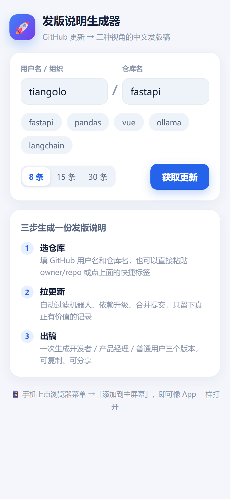
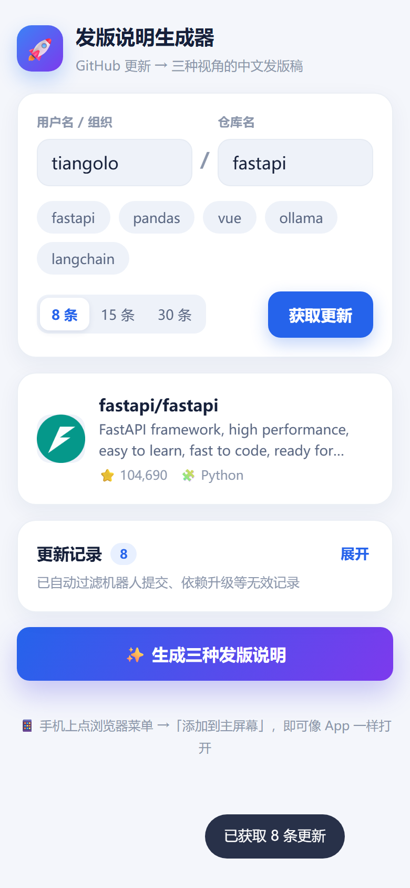
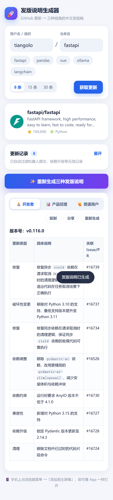

# 发版说明生成器 · Release Notes Studio

把 GitHub 仓库的最新提交，一键变成 **开发者 / 产品经理 / 普通用户** 三种视角的中文发版说明。
手机浏览器打开即用，支持「添加到主屏幕」当 App 使。

> 由你 PyCharm 里的 `clean_project` 重构而来：从「一个 main.py 塞满前后端」升级为可部署、可维护、移动端优先的正式项目。

---

## 1. 它长什么样

| 首页 | 拉取更新 | 生成结果 |
|---|---|---|
|  |  |  |

- **输入**：`用户名/仓库名`（支持直接粘贴 `owner/repo`），或点热门仓库快捷标签
- **获取**：拉取最近 8/15/30 条提交，自动过滤机器人、依赖升级、合并提交
- **生成**：调用大模型，输出三个版本，每个版本带版本号 + Markdown 表格
- **输出**：一键复制、系统分享、切换视角
- **手机**：PWA，可安装到桌面，全屏无地址栏，支持离线打开外壳

## 2. 目录结构

```
release-notes-app/
├─ app/
│  ├─ main.py            # FastAPI 入口：页面 + 接口
│  ├─ config.py          # 环境变量集中管理（密钥只留在服务端）
│  ├─ github_client.py   # GitHub 拉取 + 过滤 + 5 分钟缓存
│  ├─ ai_client.py       # 大模型调用 + 三段解析
│  ├─ templates/index.html
│  └─ static/
│     ├─ css/style.css   # 移动端优先样式（safe-area / 桌面自适应）
│     ├─ js/app.js
│     ├─ sw.js           # Service Worker（离线外壳）
│     ├─ manifest.webmanifest
│     └─ icons/
├─ requirements.txt
├─ Dockerfile
├─ start.bat             # Windows 双击即跑
├─ start.sh              # macOS / Linux / 服务器
├─ .env.example
└─ .env                  # 你的密钥，勿提交
```

## 3. 本地跑起来（Windows）

1. 双击 `start.bat`（首次会自动建虚拟环境、装依赖）
2. 若提示 `.env` 不存在，把 `.env.example` 复制为 `.env`，填入两个密钥
3. 浏览器打开 <http://127.0.0.1:8000>

命令行方式：

```bash
python -m venv .venv
.venv\Scripts\activate
pip install -r requirements.txt
uvicorn app.main:app --host 0.0.0.0 --port 8000
```

## 4. 手机立刻能用（同一 WiFi）

电脑保持运行，手机浏览器输入 `http://电脑局域网IP:8000`
（`start.bat` 启动时会打印这个地址；也可 `ipconfig` 查看 IPv4）

> 局域网是 http，能用但**不能安装到桌面**。想装成 App，需要 HTTPS，见第 6 节。

## 5. 部署到公网（三选一）

### 方案 A：Docker（自有服务器，最可控）

```bash
docker build -t release-notes .
docker run -d --name release-notes --restart unless-stopped \
  -p 8000:8000 --env-file .env release-notes
```

Nginx 反向代理 + HTTPS（域名需已解析到服务器）：

```nginx
server {
    listen 443 ssl http2;
    server_name notes.example.com;

    ssl_certificate     /etc/letsencrypt/live/notes.example.com/fullchain.pem;
    ssl_certificate_key /etc/letsencrypt/live/notes.example.com/privkey.pem;

    location / {
        proxy_pass http://127.0.0.1:8000;
        proxy_set_header Host $host;
        proxy_set_header X-Real-IP $remote_addr;
        proxy_set_header X-Forwarded-Proto $scheme;
        proxy_read_timeout 120s;   # AI 生成较慢，别用默认 60s
    }
}
```

证书：`certbot --nginx -d notes.example.com`。
国内服务器注意：**GitHub API 可能访问慢或被限速**，建议配好 `GITHUB_TOKEN`；实在不通可给服务端加代理。

### 方案 B：托管平台（无需运维）

Zeabur / Railway / Render 任意一个，导入 Git 仓库后：

- 构建方式选 **Dockerfile**
- 环境变量里填 `GITHUB_TOKEN`、`AI_API_KEY`（不要提交 .env）
- 平台会自动给 HTTPS 域名，直接可安装成 App

### 方案 C：临时公网演示（Cloudflare Tunnel，5 分钟）

```bash
winget install Cloudflare.cloudflared
cloudflared tunnel --url http://localhost:8000
```

终端会给出一个 `https://xxx.trycloudflare.com` 地址，手机直接打开即可（进程关掉即失效，适合演示）。

## 6. 装到手机桌面（像 App 一样）

| 系统 | 操作 |
|---|---|
| iPhone | Safari 打开 → 分享 → 「添加到主屏幕」 |
| Android | Chrome / Edge 打开 → 右上角菜单 → 「安装应用」或「添加到主屏幕」 |
| 桌面 Chrome | 地址栏右侧的安装图标，或页面右上角「安装」按钮 |

装完是独立图标、全屏运行、有启动色。

## 7. 环境变量

| 变量 | 必填 | 说明 |
|---|---|---|
| `GITHUB_TOKEN` | 建议 | GitHub PAT，未配置时每小时仅 60 次请求 |
| `AI_API_KEY` | 是 | 大模型密钥 |
| `AI_PROVIDER` | 否 | 一行切换供应商：`deepseek`（默认）/ `zhipu` / `zhipu-pro` / `qwen` |
| `AI_BASE_URL` | 否 | 覆盖预设接口地址（任意兼容 OpenAI 协议的服务） |
| `AI_MODEL` | 否 | 覆盖预设模型名 |
| `AI_RATE_LIMIT` | 否 | 单 IP 每小时 AI 生成次数，默认 20 |
| `DEFAULT_LIMIT` / `MAX_LIMIT` | 否 | 默认 / 最大提交条数（8 / 30） |
| `CACHE_TTL` | 否 | 提交列表缓存秒数，默认 300 |

### 用免费的智谱 GLM

```env
AI_PROVIDER=zhipu          # 自动使用 https://open.bigmodel.cn/api/paas/v4 + glm-4.5-flash
AI_API_KEY=你的智谱Key      # 在 open.bigmodel.cn → API Keys 创建
```

申请：<https://open.bigmodel.cn/usercenter/apikeys> 注册（需手机号）→ 创建 API Key，不用绑卡。

免费额度是 `glm-4.5-flash`（128K 上下文）和 `glm-4.7-flash`（200K），**限 1 并发**：
个人用没问题，多人同时点「生成」时后面的请求会排队/失败。

切换供应商对照：

| `AI_PROVIDER` | 接口 | 模型 | 备注 |
|---|---|---|---|
| `deepseek` | api.deepseek.com | deepseek-chat | 便宜稳定，默认 |
| `zhipu` | open.bigmodel.cn/api/paas/v4 | glm-4.5-flash | **免费** |
| `zhipu-pro` | 同上 | glm-4.6 | 付费，质量更接近旗舰 |
| `qwen` | dashscope 兼容模式 | qwen-plus | 阿里云百炼 |

## 8. 接口

| 方法 | 路径 | 说明 |
|---|---|---|
| GET | `/api/health` | 健康检查，返回密钥是否就绪、当前供应商与模型 |
| GET | `/api/commits?owner=&repo=&limit=` | 仓库信息 + 过滤后的提交 |
| POST | `/api/summary` | 入参 `{owner, repo, limit, commits?}`，返回 `{dev, pm, user}` |

## 9. 相比原版的改动

- 单文件拆成 `main / config / github_client / ai_client`，职责清晰
- 密钥只走环境变量，前端拿不到；`.env` 已进 `.gitignore`
- 界面重做为移动端优先：安全区适配、输入框 16px 防 iOS 缩放、表格横向滚动、加载遮罩与 toast
- 加了 PWA（manifest + service worker + 图标），可安装到桌面
- 提交缓存 5 分钟，避免反复刷 GitHub 触发限流；AI 接口按 IP 限流，防止密钥被刷
- 错误提示全部中文化（仓库不存在 / 令牌失效 / 余额不足 / 超时）
- 修复原版 `.env` 中值前带空格导致密钥读取异常的问题（配置读取时已 strip）
- AI 返回格式不按预期时会兜底，不再出现「提取失败」三连

## 10. 常见问题

**Q：手机上打开很慢？**
A：大模型生成需要 10–30 秒，属正常；接口已加 90 秒超时。想更快可换 `deepseek-chat` 以外的低延迟模型。

**Q：提示「找不到仓库」？**
A：私有仓库必须配置有 `repo` 权限的 `GITHUB_TOKEN`；公开仓库检查用户名/仓库名拼写。

**Q：用智谱免费模型时提示超时或失败？**
A：免费档限 1 并发，前一个请求没结束再来一个就会排队。等几秒重试即可；多人共用建议换 `deepseek`。

**Q：生成内容不完整？**
A：点「重新生成」；或把提交条数调小（8 条）让模型更聚焦。

**Q：能商用吗？**
A：代码是你的；请遵守 GitHub API 与所调用大模型服务的使用条款。
